[Personal Learning Record](../../personal_journal/personal_journal.md) | [Session Notes](../sessions/README.md) 

# Session 8

## Topics covered
*What topics were covered in this session*
- **Introduction to Kubernetes (K8s):** an open-source container orchestration platform, originally created by Google from its internal Borg system and now maintained by the Cloud Native Computing Foundation (CNCF). It automates the deployment, scaling and management of containerised applications.
- **Docker Compose vs Kubernetes:** Docker Compose starts a set of containers on a single host. Kubernetes manages containers across a cluster and continuously reconciles the actual state with the desired state.
- **Core architecture:** the Control Plane (API Server, etcd, Scheduler, Controller Managers) manages the cluster. Worker Nodes run the application containers using a kubelet, a container runtime and kube-proxy.
- **Kubernetes in Docker Desktop:** enabling a local single-node cluster using kubeadm (one node, lower resource use) rather than kind (Kubernetes in Docker).
- **Key objects:** Pods, Deployments, ReplicaSets, Services, Namespaces and ConfigMaps.
- **kubectl:** the command line tool used to create, inspect, debug, scale and delete Kubernetes resources.

## Personal Notes and research following this session
*Which class sessions and personal research refers to technology in this proposal. Link to examples.*
- **Pod:** the smallest deployable unit in Kubernetes. It holds one or more containers that share storage and network resources. Each pod gets its own cluster IP address (my nginx pod was given `10.1.0.6`).
- **Deployment and ReplicaSet:** a Deployment declares how many copies (replicas) of a pod should run. It creates a ReplicaSet, which makes sure that number of pods is always running. This is what gives Kubernetes its self-healing behaviour.
- **Service:** gives a stable address for a group of pods and load balances traffic between them. A `LoadBalancer` service in Docker Desktop is published on `localhost`. Pods are found using labels (for example `app: k8s-demo`), not IP addresses, because pod IPs change when pods are replaced.
- **Declarative model:** the desired state is written in YAML files and applied with `kubectl apply -f`. Kubernetes then works to make the cluster match the files. This is similar to how Ansible playbooks describe the desired state of a server.
- **ConfigMap:** stores non-sensitive settings (such as `APP_NAME` and `APP_VERSION`) and injects them into pods as environment variables. Sensitive values should go in a Secret instead and should never be committed to git.
- **Probes:** a liveness probe (`/health`) restarts a container that stops responding. A readiness probe (`/ready`) stops traffic reaching a pod until it is ready.
- **Pod security context:** the demo deployment runs as a non-root user (`runAsUser: 1001`), blocks privilege escalation, uses a read-only root filesystem and drops all Linux capabilities. From a cyber security point of view, this limits what an attacker could do if a container was compromised.
- **Character encoding:** the demo app's logo displayed as garbled characters in my browser. The app sends `Content-Type: text/html` without `charset=utf-8`, so the browser guessed the wrong encoding for the emoji.
> Example kubectl commands used in this session:
```bash
# Check which cluster kubectl is connected to
kubectl config current-context

# List the nodes in the cluster
kubectl get nodes

# List pods, services, deployments and replica sets
kubectl get all
kubectl get all -n <namespace>

# Show full details and lifecycle events of a pod
kubectl describe pod <pod-name>

# Show (or follow) the logs of a pod
kubectl logs <pod-name>
kubectl logs -f <pod-name>

# Apply a YAML configuration file
kubectl apply -f <file.yaml>

# Change the number of replicas
kubectl scale deployment <name> --replicas=<n>

# Delete resources
kubectl delete pod <pod-name>
kubectl delete deployment <name>
kubectl delete service <name>
kubectl delete namespace <namespace>
```
The commands above were used to manage the Kubernetes cluster.[^kubectl]

[^kubectl]: kubectl quick reference – https://kubernetes.io/docs/reference/kubectl/quick-reference/

Further reading: [Kubernetes concepts](https://kubernetes.io/docs/concepts/overview/), [thetips4you Intro to Kubernetes](https://www.youtube.com/watch?v=IluVqhoCChw), [learn-kubernetes](https://github.com/tomjosetj31/learn-kubernetes).

## Exercises and results
*What exercises did you complete. What results. Screen shots and notes*
# Setup: Start the Kubernetes cluster
> In Docker Desktop, Settings > Kubernetes, enable Kubernetes and select the kubeadm cluster type. Wait for "Kubernetes running".

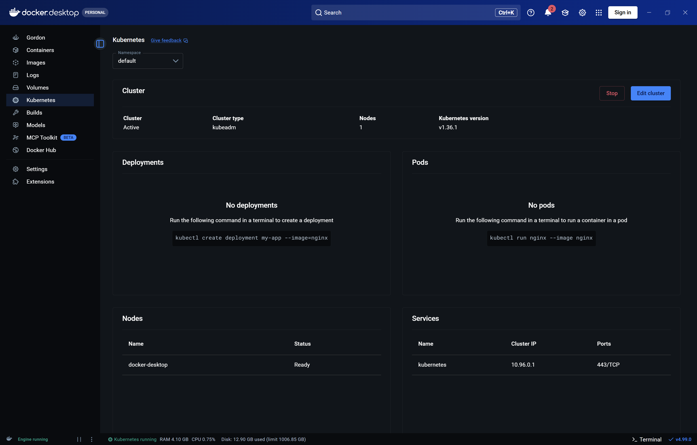
*Caption: Docker Desktop showing an active kubeadm cluster with 1 node, Kubernetes v1.36.1.*

> Confirm kubectl is connected to the cluster:
```bash
kubectl config current-context
kubectl get nodes
```
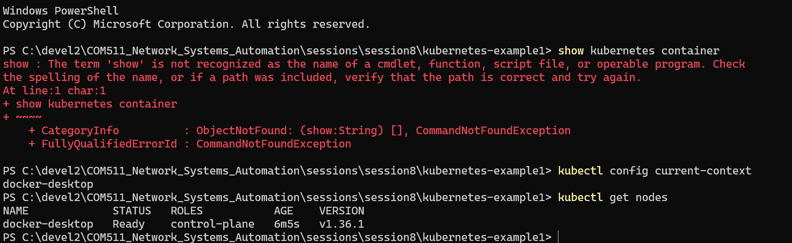
*Caption: kubectl is using the docker-desktop context and the single control-plane node is Ready.*

# Exercise 8.1: Simple nginx deployment using kubectl
> 1. Create a deployment and check the pod:
```bash
kubectl create deployment nginx --image=nginx
kubectl get pods
```
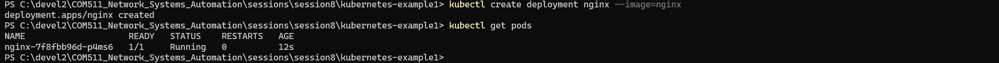
*Caption: The nginx deployment was created and its pod is Running.*

> 2. View all resources:
```bash
kubectl get all
```
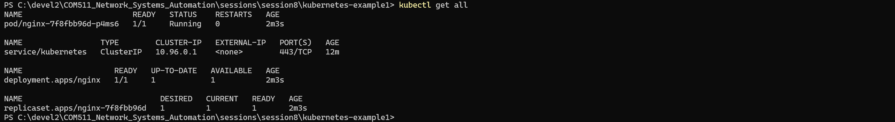
*Caption: One command creates a pod, a deployment and a replica set. The `kubernetes` service is the cluster's own API service.*

> 3. Describe the pod:
```bash
kubectl describe pod nginx-7f8fbb96d-p4ms6
```
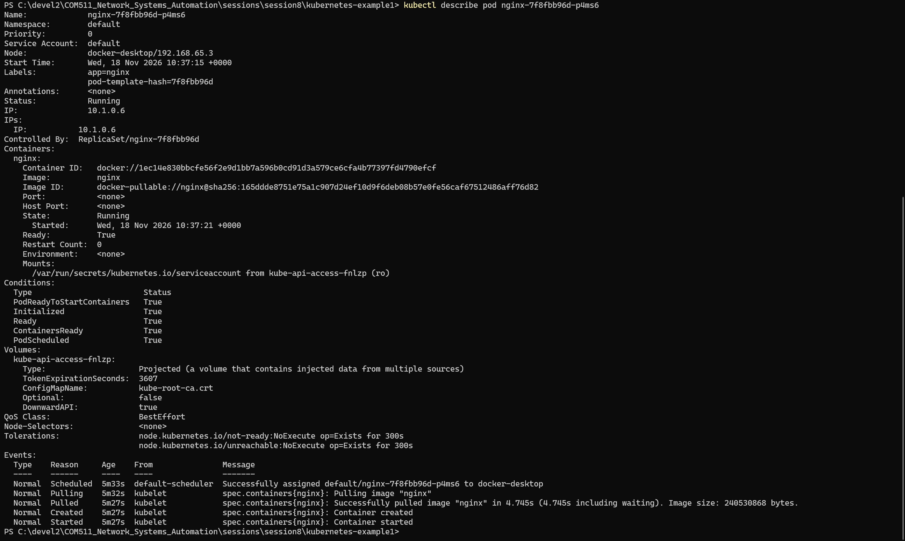
*Caption: The pod runs on node docker-desktop, has IP 10.1.0.6 and is controlled by ReplicaSet/nginx-7f8fbb96d. The Events show the scheduler assigning the pod, then the kubelet pulling the image and starting the container.*

> 4. View the pod logs:
```bash
kubectl logs nginx-7f8fbb96d-p4ms6
```
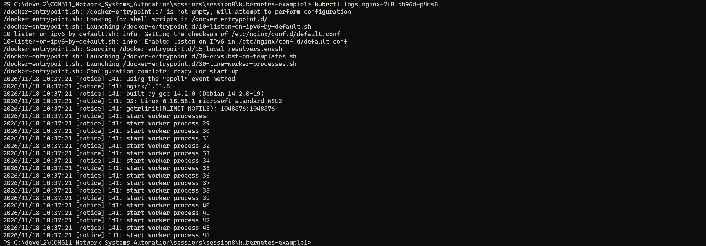
*Caption: The nginx container configuring itself and starting its worker processes inside the pod.*

> 5. Expose the deployment through a load balancer:
```bash
kubectl expose deployment nginx --port=80 --type=LoadBalancer
```
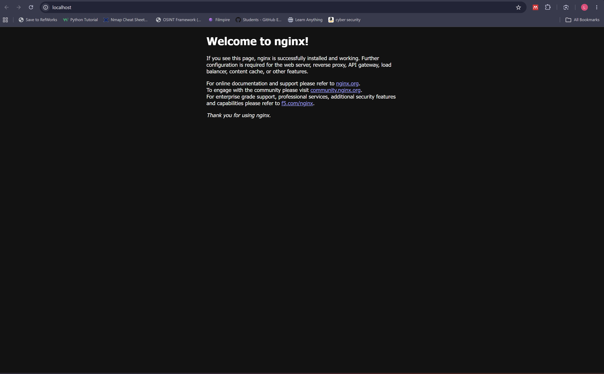
*Caption: The nginx welcome page reached at http://localhost through the Kubernetes service.*

> 6. Test self-healing by deleting the pod:
```bash
kubectl delete pod nginx-7f8fbb96d-p4ms6
kubectl get pods
```
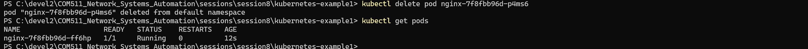
*Caption: Pod p4ms6 was deleted and the ReplicaSet created a replacement pod (ff6hp) within 12 seconds.*

> 7. Clean up:
```bash
kubectl delete deployment nginx
kubectl delete service nginx
```
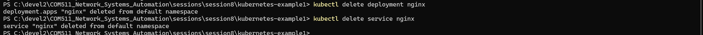
*Caption: Deleting the deployment removes its replica set and pods. The service must be deleted separately.*

# Exercise 8.2: Deploying an application using YAML configuration files
> Deploy the demo Node.js application from the `kubernetes-example1` folder:
```bash
cd sessions\session8\kubernetes-example1

# Create the namespace, then the config, deployment and service
kubectl apply -f k8s/namespace.yaml
kubectl apply -f k8s/configmap.yaml
kubectl apply -f k8s/deployment.yaml
kubectl apply -f k8s/service.yaml

# Check status
kubectl get all -n k8s-demo
```
> Key parts of `deployment.yaml` and `service.yaml`:
```yaml
# deployment.yaml
spec:
  replicas: 3                 # ReplicaSet keeps 3 pods running
  template:
    spec:
      containers:
        - name: app
          image: ghcr.io/shazforiot/k8s-beginner-project:main
          ports:
            - containerPort: 3000
          envFrom:
            - configMapRef:
                name: app-config   # settings from configmap.yaml

# service.yaml
spec:
  type: LoadBalancer
  selector:
    app: k8s-demo             # sends traffic to pods with this label
  ports:
    - port: 80                # external port
      targetPort: 3000        # container port
```
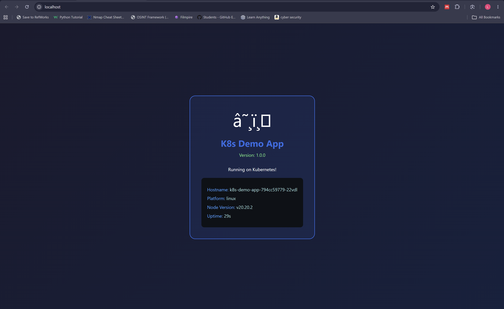
*Caption: The demo app reached at http://localhost. The Service forwards port 80 to port 3000 in a pod. The hostname shown is the name of the pod that answered the request.*

> Scale the deployment up and back down:
```bash
kubectl scale deployment k8s-demo-app -n k8s-demo --replicas=5
kubectl get all -n k8s-demo

kubectl scale deployment k8s-demo-app -n k8s-demo --replicas=4
kubectl get all -n k8s-demo
```
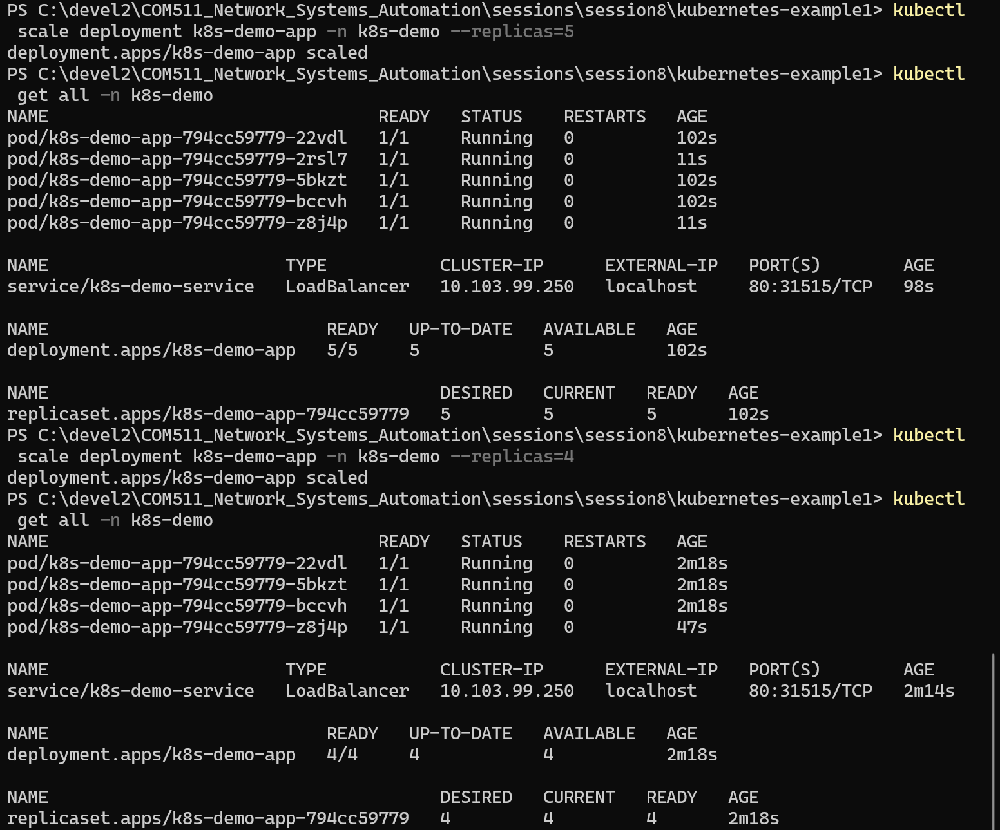
*Caption: Scaling to 5 replicas added two new pods (age 11s). Scaling down to 4 removed one of them. The ReplicaSet DESIRED, CURRENT and READY counts match each time, and the LoadBalancer service stays on localhost port 80.*

> Clean up the demo by deleting the namespace, which removes everything in it:
```bash
kubectl delete namespace k8s-demo
```

## Summary of learning
*What did you learn through these exercises*
- understand the difference between Docker Compose and Kubernetes
- understand the Kubernetes architecture (control plane and worker nodes)
- understand pods, deployments, replica sets, services, namespaces and ConfigMaps
- able to use basic kubectl commands to create, inspect, debug, scale and delete resources
- seen Kubernetes self-healing by deleting a pod and watching it be replaced
- deploy an application declaratively using YAML files and `kubectl apply`
