[Personal Learning Record](../../personal_journal/personal_journal.md) | [Session Notes](../sessions/README.md) 

# Session 9

## Topics covered
*What topics were covered in this session*
- Understanding what VPN is, how it works, how to implement it, and why we need it.
- how to set up a VPN to a 'road warrior'.
- how to set up a peer to peer vpn.
- what benefits opnsense might provide.
- Virtual Private Networks (VPNs): remote access (road warrior) and site-to-site
- OPNsense 24.7 firewall deployed with Vagrant and VirtualBox
- Public Key Infrastructure: certificate authorities, server certificates and client certificates
- OpenVPN server configuration on OPNsense
- Firewall rules per interface (Floating, LAN, Loopback, WAN, OpenVPN)
- Static routing on Windows with `route ADD`, checked with `tracert`
- Exporting a client profile and connecting with OpenVPN Connect 

## Personal Notes and research following this session
This session builds on the earlier infrastructure-as-code sessions, because the whole firewall was created from a Vagrantfile instead of being installed by hand. The first `vagrant up` bootstraps OPNsense onto a FreeBSD box (`punktde/freebsd-141-ufs`) and then shuts the VM down on purpose. A second `vagrant up` starts the finished firewall, with the web UI at https://192.168.56.56.
The lab setup is not hardened. SSH is allowed on all interfaces, private networks are not blocked on WAN, and the default root password is used. That is acceptable on a host-only lab network, but it would be a serious risk on a real network.
OPNsense offers several VPN types. IPsec is mainly used for site-to-site links that join two whole networks. OpenVPN is commonly used for remote access, where one user's device connects into a network. I chose OpenVPN for remote access because it runs over a single UDP port (1194) and uses TLS with certificates, so it passes through NAT and firewalls easily.
OpenVPN authenticates both sides with certificates signed by the same CA (mutual TLS). In my setup the server also checks a username and password against the local user database, so a client needs both the certificate and the password to connect. After the TLS handshake, normal IP traffic is encapsulated and encrypted inside UDP packets. The client is given an address from the tunnel network and a route to the LAN behind the firewall.
The route exercise in the original README had the wrong subnet mask. The network 217.29.32.0 is a /20, so the mask has to be 255.255.240.0.
Research and references:
- OPNsense documentation, Setup SSL VPN Road Warrior: https://docs.opnsense.org/manual/how-tos/sslvpn_client.html
- OpenVPN community how-to: https://openvpn.net/community-resources/how-to/
- WireGuard, a newer VPN protocol that OPNsense also supports: https://www.wireguard.com/
- Course repo, session 9 Vagrant files: https://github.com/Lin-DDOS/COM511_Network_Systems_Automation/tree/main/sessions/session9/vagrant-opnsense

## Exercises and results
*What exercises did you complete. What results. Screen shots and notes*

### Exercise 1: Deploy OPNsense with Vagrant
I ran `vagrant up` once to bootstrap OPNsense, which shut the VM down when it finished, and then ran `vagrant up` again to start the firewall.
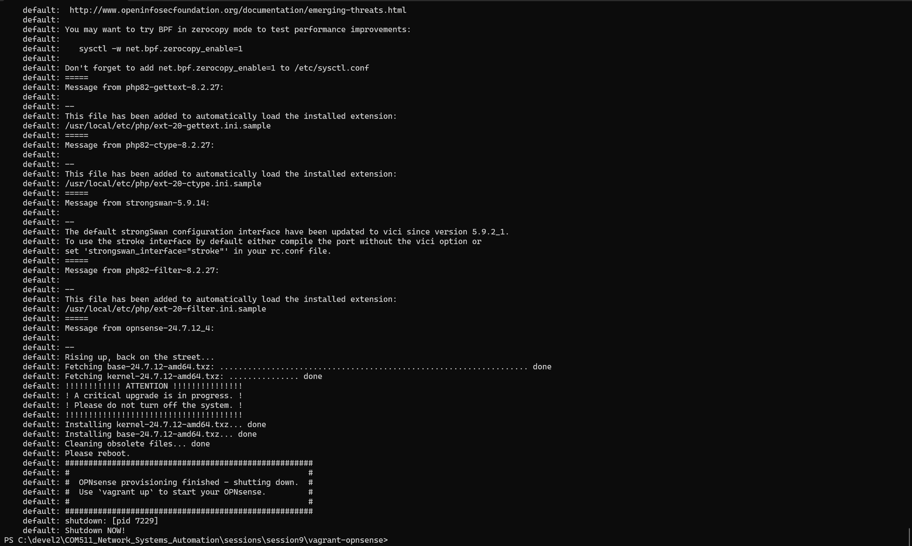
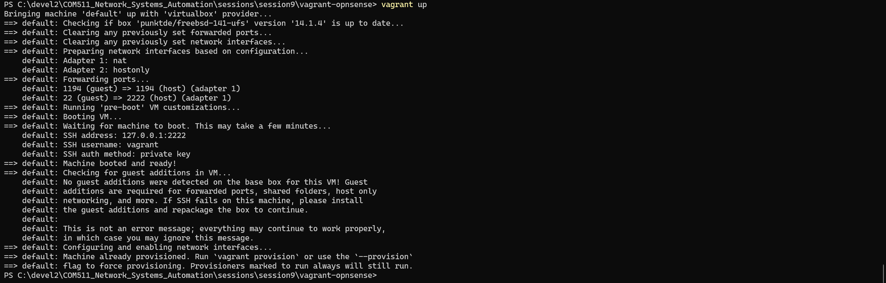

I logged in to the web UI at https://192.168.56.56 as root. The dashboard showed OPNsense running.

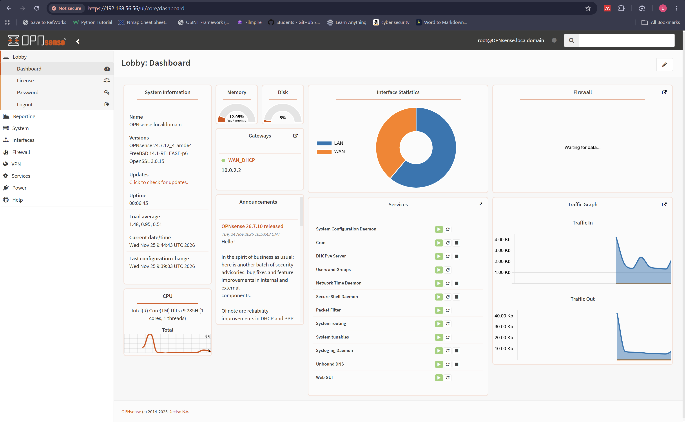

### Exercise 2: Review the firewall rules
Rules are split into tabs per interface: Floating, LAN, Loopback and WAN. The Floating tab holds the rule that allows SSH on all interfaces. LAN has the default allow rules.
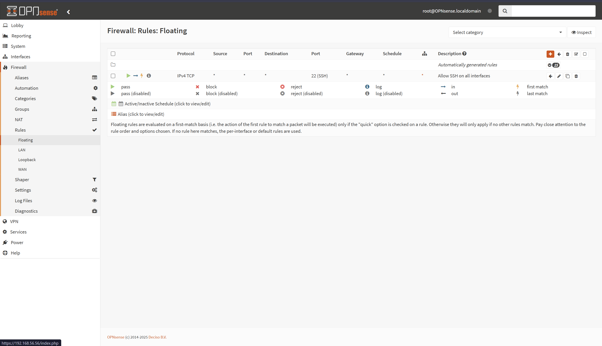
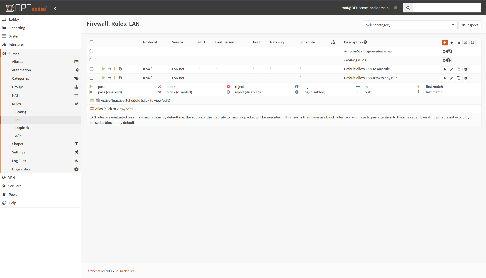

### Exercise 3: Explore the VPN options 
The VPN menu offers IPsec, OpenVPN and WireGuard. Under IPsec, Mobile Clients is used for road-warrior access and Connection is used for Site-to-site tunnles.
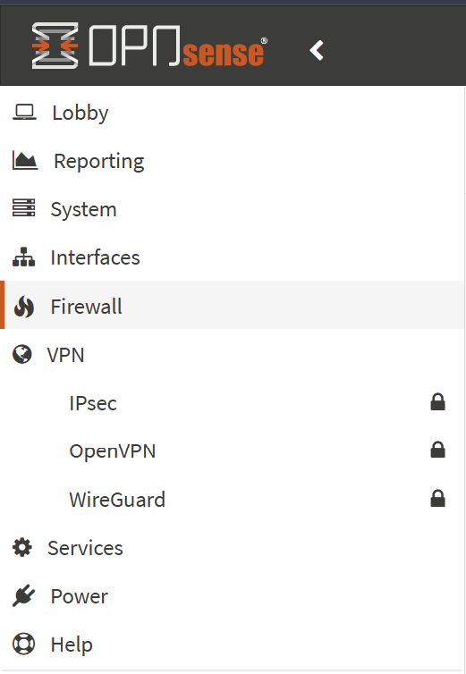
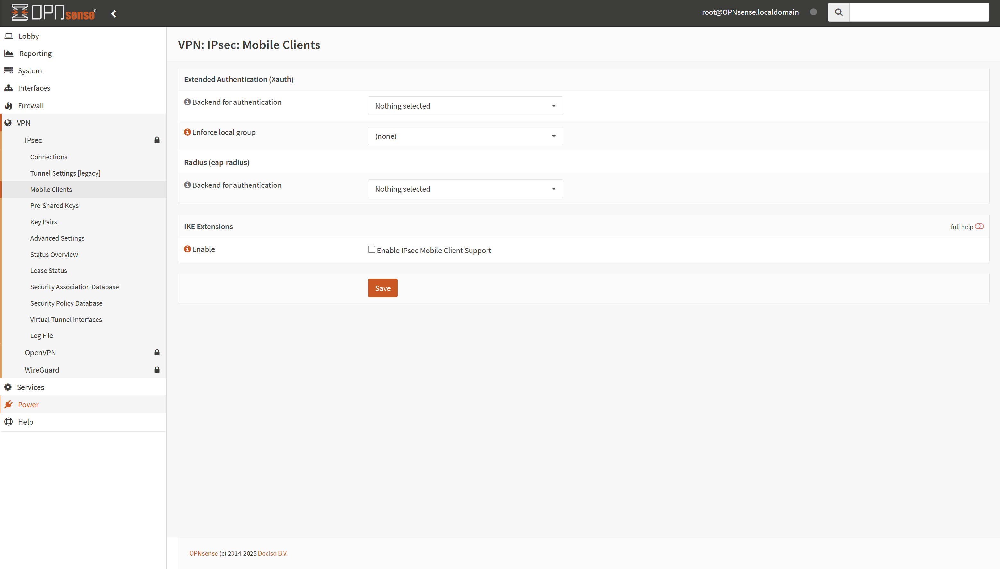
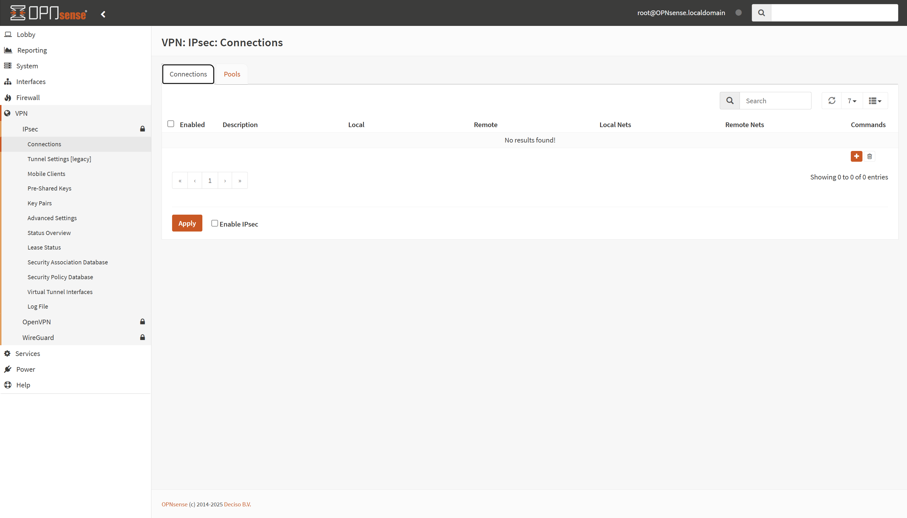

### Exercise 4: Build an OpenVPN road-warrior VPN
1. I created a certificate authority, `LabCA`, under System > Trust > Authorities. I then created the server certificate `vpn-server`, signed by LabCA.
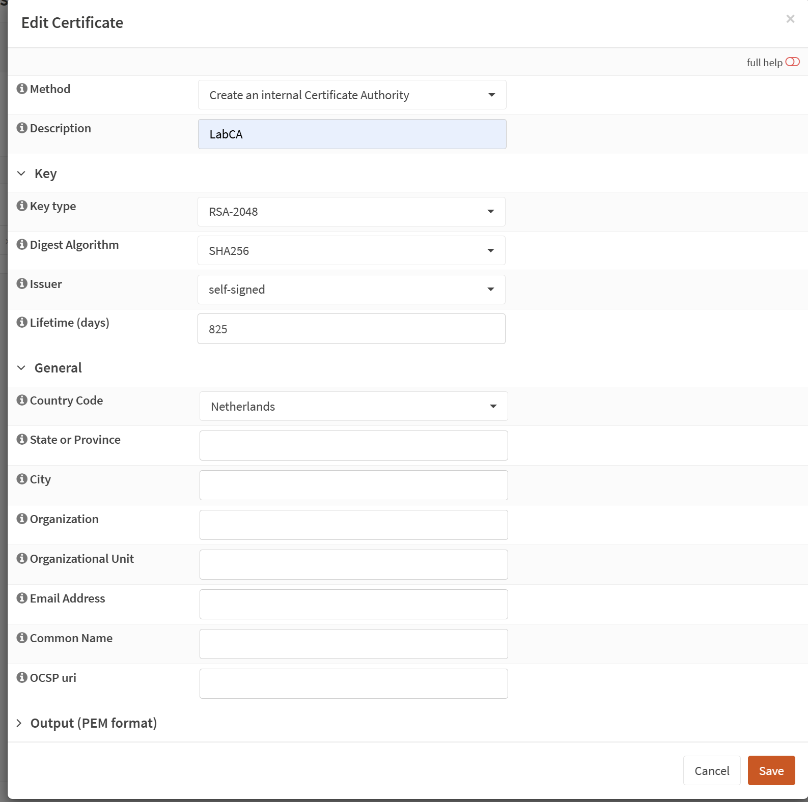
2. I created user `lin` with a client certificate signed by LabCA.
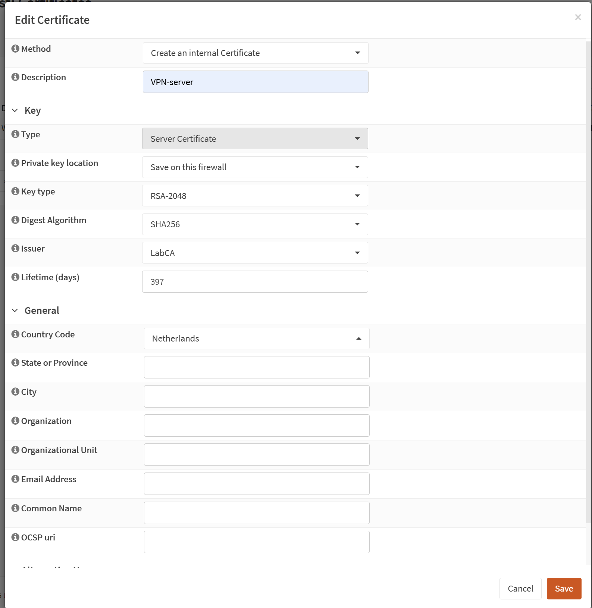
3. I created an OpenVPN server instance: UDP, port 1194, tunnel network 10.10.10.0/24, certificate vpn-server, Local Database authentication, local network 192.168.56.0/24.
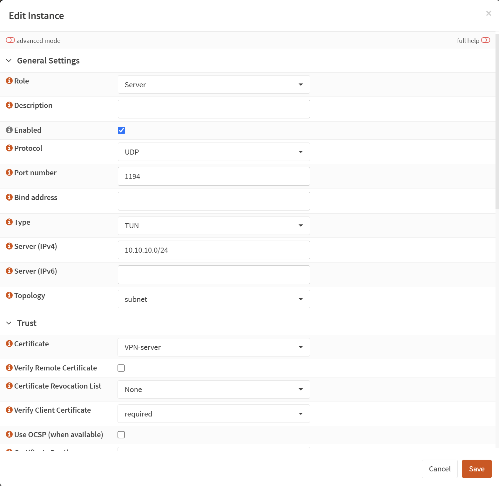
4. I added a WAN pass rule for UDP port 1194, so the encrypted traffic is let in. I also added a pass rule on the OpenVPN tab, which controls what clients can reach once the traffic is decrypted.
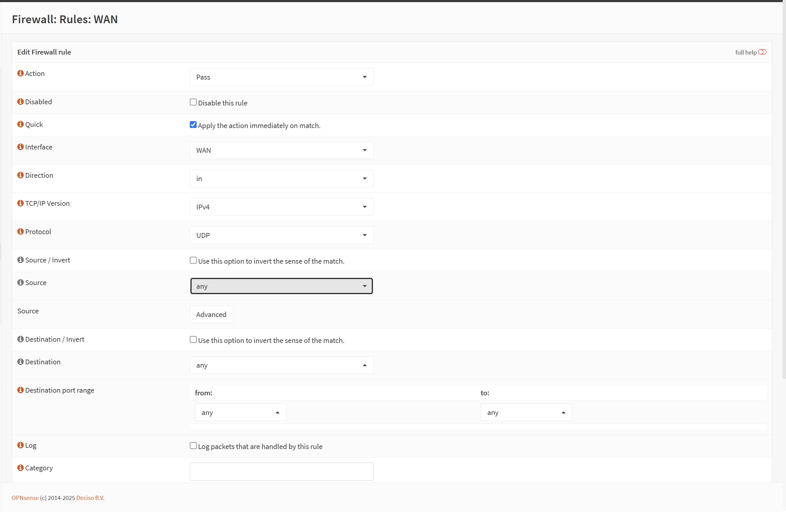
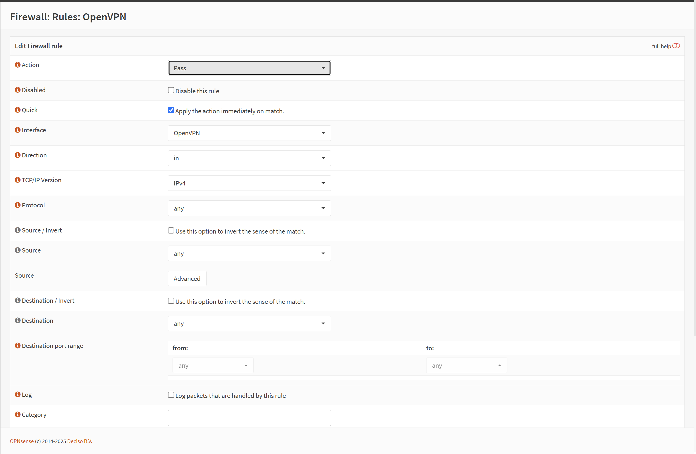
5. I exported the client profile with host 127.0.0.1, which works through the Vagrant port forward.
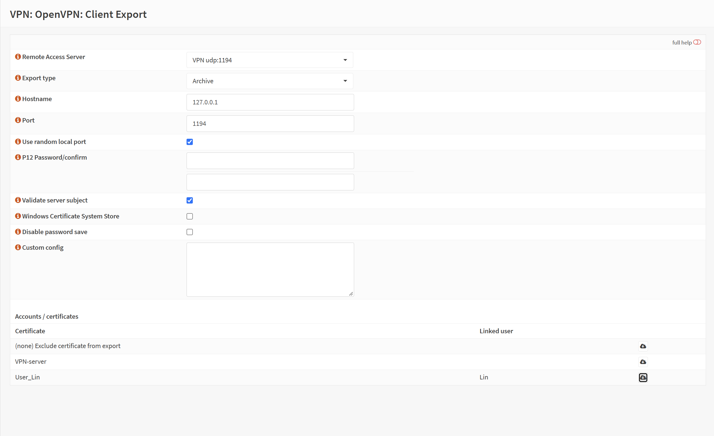
**Problem:** OpenVPN Connect showed "Missing external certificate". The profile I had imported did not contain the client certificate. I fixed it by checking that user `lin` had a certificate, then exporting again from the row that included that certificate.
6. After importing the new profile, the client connected.
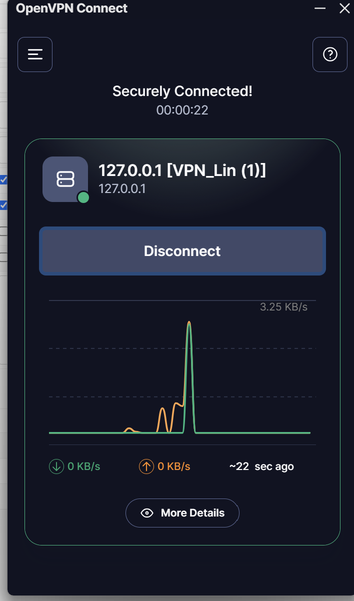
**Result:** `ipconfig` showed a new adapter with IPv4 address 10.10.10.2 and mask 255.255.255.0, which is inside the tunnel network.
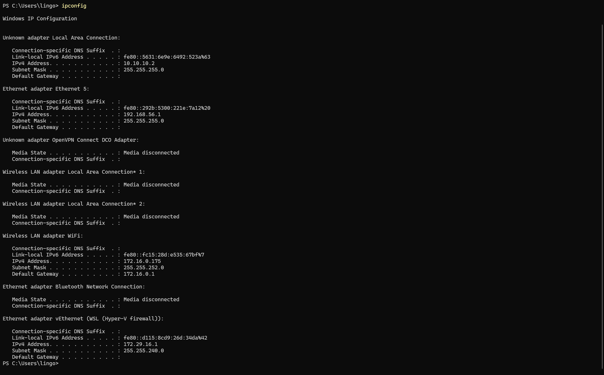
`ping 10.10.10.1` reached the server end of the tunnel with 4 packets sent, 4 received, 0% loss, and an average time of 2 ms.
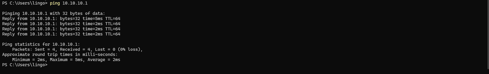

## Summary of learning
*What did you learn through these exercises*
